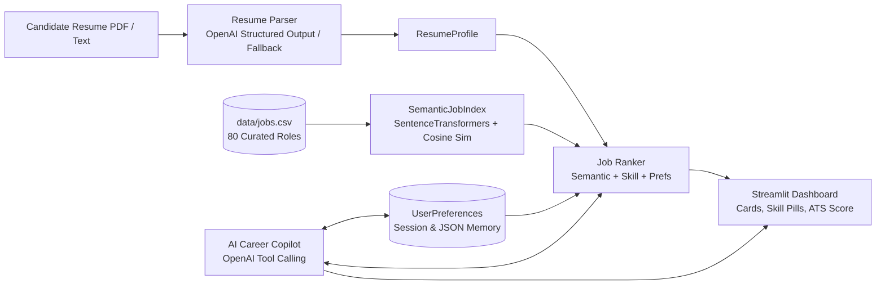

# CareerPilot AI — Intelligent Job Search & Career Agent

An AI-powered career assistant that analyzes a candidate's resume into structured skills and experience, searches a curated dataset of 80 technical roles using semantic embeddings, ranks opportunities with matched/missing skill breakdowns, and provides a tool-calling AI Career Copilot with persistent preference memory.

---

## Core Features

| Feature | Implementation | What It Demonstrates |
|---|---|---|
| **Resume Analyzer** | PDF (`pypdf`) & text extraction + OpenAI Structured Outputs (`pydantic` schema) with local taxonomy fallback | LLM prompting, structured outputs, graceful degradation |
| **Semantic Job Search** | Sentence Transformers (`all-MiniLM-L6-v2`) + Scikit-learn `cosine_similarity` (with TF-IDF fallback) | Dense vector embeddings & semantic retrieval |
| **Personalized Job Ranking** | Weighted scoring across semantic similarity (50%), skill overlap with alias normalization (35%), and preference fit (15%) | Ranking algorithms, skill gap analysis, personalization |
| **AI Career Copilot** | OpenAI function/tool calling (`search_jobs`, `get_job_details`, `analyze_skill_gap`, `save_user_preference`) | Agentic workflows & multi-turn tool orchestration |
| **Preference Memory** | `st.session_state` + local JSON persistence (`.careerpilot_state.json`) | Context retention & memory across queries and sessions |

---

## Architecture



---

## Project Structure

```text
.
├── app.py                              # Streamlit dashboard entrypoint
├── data/
│   ├── jobs.csv                        # Curated dataset of 80 technical & AI roles
│   └── sample_resumes/                 # Ready-to-test sample candidate profiles
├── src/
│   └── careerpilot/
│       ├── agent.py                    # OpenAI tool-calling CareerPilot Agent & fallback
│       ├── config.py                   # Environment & path configuration
│       ├── data_loader.py              # Pandas dataset & sample resume loaders
│       ├── embeddings.py               # Sentence Transformers + Scikit-learn cosine engine
│       ├── matcher.py                  # Ranking, skill normalization, ATS readiness
│       ├── models.py                   # Pydantic domain schemas
│       ├── resume_parser.py            # PDF extraction + OpenAI structured output parser
│       ├── storage.py                  # Local JSON preference/profile memory
│       └── ui/
│           ├── components.py           # KPI cards, job cards, skill badges
│           └── styles.py               # Custom dashboard CSS
├── tests/
│   ├── test_matching_and_agent.py      # Ranking, skill gap & tool-calling tests
│   └── test_resume_and_data.py         # Dataset, PDF/resume parser & storage tests
├── .env.example
├── pyproject.toml
├── requirements.txt
└── README.md
```

---

## Quickstart

### 1. Clone & Create Virtual Environment

```bash
python -m venv .venv
# Windows PowerShell
.\.venv\Scripts\Activate.ps1
# macOS / Linux
source .venv/bin/activate

pip install -r requirements.txt
```

### 2. Configure Environment (Optional for Live OpenAI Mode)

```bash
cp .env.example .env
# Edit .env and add your OPENAI_API_KEY
```

> **Note:** CareerPilot AI works out-of-the-box even without an `OPENAI_API_KEY` using its built-in deterministic resume parser, Sentence Transformers / TF-IDF semantic search, and local tool-calling demo copilot. Adding an OpenAI API key in `.env` or the sidebar enables live GPT-4o-mini structured outputs and reasoning.

### 3. Run the Streamlit App

```bash
streamlit run app.py
```

### 4. Run Tests & Linter

```bash
pytest
ruff check src tests app.py
```

---

## Roadmap (Future Extensions)

- PostgreSQL + `pgvector` persistence for multi-user profiles and job catalogs
- LangGraph stateful multi-agent interview prep & resume tailoring workflows
- Docker containerization and CI/CD workflow
- Automated RAG & ranking evaluation benchmarks (NDCG@k, MRR)
